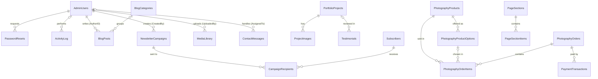

# CMS Architecture

**Status: Phase 12.**

- **Database:** 31 tables. `database/schema.sql` creates 29, and `database/migrations.sql` adds `PageSections` and `PageSectionItems`, edit stamps (`LastEditedBy`, `LastEditedDate`) on every editable content table, Media Library captions and optimisation details, and the starting content.
- **Install:** run `php database/setup.php`.
- **Built:** every content screen the public website needs, the blog, the Media Library, Contact Messages, Subscribers, user management, and email (contact notifications, newsletter confirmation, password resets, invitations).
- **Placeholders only:** photography store.

## 1. How content survives deployments

| Risk | Protection |
|---|---|
| Deploying code replaces content | All content is in database rows, and deployments only replace code files |
| Re-running setup wipes or restores data | No `DROP` or `TRUNCATE` anywhere. Tables use `CREATE TABLE IF NOT EXISTS`. Content seeds run once only, so edited or removed text never comes back |
| Uploaded images are deleted | `uploads/` is in `.gitignore`. Any deployment that mirrors files must also exclude it, or every uploaded image is lost |
| Structure needs to change later | Changes go in `migrations.sql` as additive statements, recorded in `SchemaMigrations` |

Back up the database and `uploads/` separately. Git holds neither.

**Migrations so far:** 002 edit stamps · 003 location defaults · 004 services · 005 Home and About wording · 006 page sections · 007 removal of footer menu headings · 008 rename to Colour & Design Psychology · 009 gallery image stamps · 010 service, portfolio, contact and legal page wording · 011 Media Library captions and stamps · 012 image optimisation details · 013 blog (category edit stamps, "Blog" subscriber source, blog page wording, starting categories) · 014 newsletter campaigns (campaign content columns, link to a blog post, Ready and Sending statuses, claimed recipient rows, Skipped result, test send history) · 015 version history · 016 sharing picture, newsletter round-ups, welcome email · 017 before-and-after photos, testimonials section, consultation booking, tagline style · 018 booking area wording · 019 search engines and AI assistants · 020 security and privacy, statistics, gift vouchers · 021 Vanessa's questionnaire answers (hero headline, job title, areas including Africa and Kenya, story and journey, mission and vision, eleven values, qualifications and memberships, first speaking engagement, personal philosophy quote, biophilic service renamed Biophilic & Well-being Design with her definition, sectors and six benefits, home key messages, FAQ about AI, budgets and working abroad, Interior Design enquiry type) · 022 collaborator cards (`Country`, `Email`, `Phone`, `ImageFit`) · 023 photo position and zoom (`MediaLibrary.FocusX`, `FocusY`, `Zoom`) · 024 first person: the page wording says "I", "me" and "my" instead of "Vanessa" (search descriptions, the short bio, the Privacy Policy and her name in Website Settings keep her name). Like the other wording migrations it only replaces text still at its original value, and only adds qualifications when there are none.

After changing seeded wording, regenerate `includes/content-fallback.php` from a freshly set-up database so the "database down" copy matches.

## 2. ERD



Every editable content table also has `LastEditedBy` → `AdminUsers`. Those links are left out of the diagram for readability.

**Connected groups**

- **Staff and security.** `AdminUsers` links to password resets, the activity log, uploads, and everything staff author, handle or edit.
- **Page wording.** `PageSections` hold headings, introductions and buttons for any page, found by `PageKey` and `SectionKey`. `PageSectionItems` hold their repeating blocks.
- **Portfolio.** A project owns many gallery images and can be linked from testimonials.
- **Blog.** A post has one author (who created it) and at most one category.
- **Store** (not built). One checkout is one order. An order contains many items, and each item is a product with an optional print option. Payments attach to the order.
- **Newsletter.** A campaign may come from one blog post (`BlogID`, set to empty if the post is deleted). `CampaignRecipients` joins campaigns and subscribers, one row per person per campaign. `CampaignTestSends` keeps every test email.

**Standalone tables**

- Always one row, created by the schema: `WebsiteSettings`, `HomePageContent`, `AboutContent`.
- No foreign keys apart from edit stamps: `AboutValues`, `AboutQualifications`, `SitePages`, `Services`, `Collaborators`, `SpeakingEngagements`, `LoginAttempts`, `SchemaMigrations`.

**Images.** Image columns store a path inside `uploads/` and are not foreign keys to `MediaLibrary`. Instead:

- The admin only accepts a path that exists in `MediaLibrary`.
- The Media Library checks every image column before allowing a delete.
- `MediaLibrary.FilePath` is unique.

## 3. Table relationships

| Child column | Parent | Required | If the parent is deleted |
|---|---|---|---|
| `PasswordResets.AdminUserID` | `AdminUsers` | Yes | **Cascade** |
| `ActivityLog.AdminUserID` | `AdminUsers` | No | **Set null:** the log entry stays |
| `*.LastEditedBy` (every editable table) | `AdminUsers` | No | **Set null:** the edit date stays, the name clears |
| `BlogPosts.AuthorID` | `AdminUsers` | Yes | **Blocked:** deactivate the user instead |
| `NewsletterCampaigns.CreatedBy` | `AdminUsers` | Yes | **Blocked** |
| `MediaLibrary.UploadedBy` | `AdminUsers` | Yes | **Blocked** |
| `ContactMessages.AssignedTo` | `AdminUsers` | No | **Set null:** message becomes unassigned |
| `BlogPosts.CategoryID` | `BlogCategories` | No | **Set null:** post stays, uncategorised |
| `ProjectImages.ProjectID` | `PortfolioProjects` | Yes | **Cascade:** images removed with the project |
| `Testimonials.ProjectID` | `PortfolioProjects` | No | **Set null:** testimonial stays |
| `PhotographyProductOptions.PhotoID` | `PhotographyProducts` | Yes | **Cascade** |
| `PhotographyOrderItems.PhotoID` | `PhotographyProducts` | Yes | **Blocked:** archive the product instead |
| `PhotographyOrderItems.OptionID` | `PhotographyProductOptions` | No | **Set null:** the order keeps its copied label and price |
| `PhotographyOrderItems.OrderID` | `PhotographyOrders` | Yes | **Blocked** |
| `PaymentTransactions.OrderID` | `PhotographyOrders` | Yes | **Blocked:** payment history is permanent |
| `CampaignRecipients.CampaignID` | `NewsletterCampaigns` | Yes | **Blocked** |
| `CampaignRecipients.SubscriberID` | `Subscribers` | Yes | **Cascade:** so a POPIA erasure is complete |
| `PageSectionItems.SectionID` | `PageSections` | Yes | **Cascade:** items are removed with their section |

**Other rules enforced by the database:**

- Unique, case-insensitive email on `AdminUsers` and `Subscribers`.
- Unique slugs on every table that has one, and unique `PageKey` + `SectionKey`.
- Unique `OrderNumber`, `PaymentReference`, `DownloadToken` and `UnsubscribeToken`.
- One person per campaign.
- One `PaymentTransactions` row per gateway reference and status, so a repeated PayFast notification cannot be recorded twice.
- Prices cannot be negative, and quantities must be above zero.

**Slugs** are on every record that can have its own web address: `Services`, `PortfolioProjects`, `Collaborators`, `SpeakingEngagements`, `PhotographyProducts`, `BlogCategories`, `BlogPosts`, `SitePages`. Admin screens build a slug from the title when it is left blank.

**Stored values that differ from what is shown.** `PortfolioProjects.PortfolioCategory` and `ContactMessages.EnquiryType` store `Colour Psychology`. The admin and public forms display it as **Colour & Design Psychology**. The service's web address stays `colour-psychology`.

**Design notes**

| Item | How it works |
|---|---|
| Statuses | Draft / Published / Archived on all public content. Workflow tables (orders, messages, campaigns, subscribers) have their own values |
| Service inclusions | `IncludedItems` and `IdealFor`, one item per line, edited in a text box |
| Values and qualifications | Rows in `AboutValues` and `AboutQualifications`. `AboutContent.CoreValues` and `AboutContent.Qualifications` hold each section's introduction |
| Retired columns | `HomePageContent.IntroductionText` and `AboutContent.Journey`, `ScienceBackground`, `DesignBackground`, `Philosophy` and `SpeakingIntroduction` are empty. Their wording moved to page sections, and they are hidden from the admin |
| Legal page wording | Plain text: a blank line separates paragraphs, `## ` starts a heading, `- ` starts a list item |
| Cart and products | `PhotographyOrderItems` hold cart lines. Prints and digital downloads are both supported until Vanessa decides |
| Stored tokens | Password reset and download tokens are stored only as hashes. `UnsubscribeToken` is stored as issued, because each email has to include it |

**Rules enforced by the admin screens:**

- Projects need `ClientPermission` before publishing. Testimonials and collaborators need a `ConsentDate`. This is checked whoever publishes.
- An Editor never sees the Status or slug fields of publishable content, so anything an Editor creates starts as Draft.
- A street address only appears on the site when `WebsiteSettings.ShowAddress` is on. It is off by default.
- Every image field accepts only an image that is in the Media Library.
- Campaigns will only go to subscribers with `SubscriptionStatus = 'Subscribed'` and a `ConfirmedDate` (newsletter phase).

**Subscriber rule** (for the contact-form phase). When "Subscribe to Newsletter" is ticked, this statement adds the person or re-subscribes them. It was tested with a new person, an existing person in different capitalisation, and someone who had unsubscribed. Someone returning after unsubscribing must confirm by email again.

```sql
INSERT INTO Subscribers (Name, Email, Source, ConsentDate, ConsentIP, UnsubscribeToken)
VALUES (?, ?, 'Contact Form', NOW(), ?, ?)
ON DUPLICATE KEY UPDATE
    SubscribedDate = IF(SubscriptionStatus = 'Unsubscribed', CURRENT_TIMESTAMP, SubscribedDate),
    ConfirmedDate  = IF(SubscriptionStatus = 'Unsubscribed', NULL, ConfirmedDate),
    ConsentDate    = VALUES(ConsentDate),
    ConsentIP      = VALUES(ConsentIP),
    SubscriptionStatus = 'Subscribed',
    UnsubscribedDate = NULL,
    Name = COALESCE(Name, VALUES(Name));
```

The order of these assignments matters: `SubscriptionStatus` must change after the two `IF` lines have read it.

## 4. Media Library

| Feature | How it works |
|---|---|
| Upload from the page | Every image field is a drop zone with a "browse" link. The upload happens immediately and shows a preview. The image is recorded in `MediaLibrary`, with its category set to the screen it came from |
| Reuse | "Choose from library" opens a searchable window, 24 images at a time. The chosen image's description and caption fill any empty matching fields |
| Several at once | The Media Library page and each project's gallery accept multiple dropped files. Gallery drops become gallery images directly |
| Library page | Search by file name, description, caption or category. Filter by category. Previews, 48 per page, with a "Needs description" marker |
| Image details | Edit description (alt text), caption and category. Shows size, dimensions, upload date and every place the image is used |
| Learning descriptions | A description typed on a content form is saved to the library if the image has none, ready for reuse |
| Position and zoom | `assets/js/photo-adjust.js` + `assets/css/photo-adjust.css` (loaded on admin screens and, for signed-in staff who may edit media, on the website). Opened from: an **Adjust photo** button over each framed photo on the website (the page updates as soon as it is saved), **Adjust position and zoom** on every image field and each picture's Media Library page, and **Adjust how it sits in the frame** in the message after a photo is added to a field. The window shows the photo in three frame shapes (tall arch, card, wide header); the shape it was opened from comes first, marked "On this page" (image fields name theirs with `'frame' => 'tall'` or `'card'` in cms-modules.php). Drag it, use the arrow keys, the mouse wheel or a two-finger pinch; the slider zooms from 100% to 300% (never below, so a photo always fills its frame). A frame where the photo would be stretched beyond its own pixels says "May look blurry at this zoom" (based on the picture's size and each frame's typical width). Saved on the picture (`MediaLibrary.FocusX`, `FocusY`, `Zoom`, migration 023) through `admin/media-framing.php` and logged as `reframe`, so it applies wherever the picture is used. `image_framing()` in content.php adds `--fx`, `--fy` and `--zoom` to the picture on the website; the CSS uses them for `object-position` and a scale around that point in arch frames, cards, collaborator photos and page headers (small round photos: position only). Not used for article pictures (shown whole) or before-and-after sliders (the two photos must line up) |
| Deleting | Admins only, and only when the image is unused. The file is removed from disk and the deletion is logged |
| Accepted files | JPG, PNG, WebP and GIF up to 10 MB, checked by their actual content. SVG and HEIC are refused |
| Storage | `uploads/media/YYYY/MM/` with a generated name (`name-1a2b3c4d.jpg`), so uploads can't overwrite files or choose their own extension |
| Protection | `.htaccess` blocks scripts anywhere in `uploads/`, confirmed on Apache |
| Optimisation | Every upload is turned upright from the camera's orientation, then saved in three sizes: **main** (up to 1920px wide, used for heroes and stored as `FilePath`), **web** (up to 1200px wide, used for content) and **thumb** (up to 400px on its longest side, used in the admin). JPEG quality 82 and progressive, WebP quality 80, PNG lossless. Images are never enlarged, and a size is never bigger than the upload |
| Originals | The untouched upload is kept in `uploads/originals/`, which the web server refuses to serve. Public versions are re-encoded, removing hidden data such as GPS location |
| Special cases | Animated GIF and WebP files are used as uploaded, so they keep their animation (`Optimisation = 'Unchanged'`). Images over 50 megapixels are refused |
| Failure handling | If an image can't be processed, the upload still succeeds using the original file, the editor sees a warning, the error is logged, and the library marks it "Not optimised" (`Optimisation = 'Failed'`) |
| Metadata | `Width`, `Height` and `FileSize` describe the main image. `OriginalPath`, `OriginalWidth`, `OriginalHeight` and `OriginalFileSize` describe the upload. The details screen lists every size with its dimensions and file size |
| Existing images | Images uploaded before optimisation keep working at full size. `php database/optimise-media.php` converts them without changing any saved path |

## 4a. Email, contact form and newsletter

| Part | How it works |
|---|---|
| Sending | Every email goes through `mail_send()` in `includes/mail.php`, using PHPMailer over SMTP. Settings come only from `.env`. `MAIL_MAILER=log` writes emails to `logs/mail/` instead, for development |
| Templates | One file per email in `includes/mail-templates/`. Each returns a subject, heading, HTML and plain text; a shared branded layout wraps the HTML. Every value is escaped. A new email is one new template |
| Links in emails | Built from `APP_URL`, never from the visitor's request, so a forged Host header can't redirect a reset link. In production, no email is sent if `APP_URL` is missing |
| Timing | Emails are sent after the visitor's page has been delivered (`mail_send_later()`), so nobody waits for the mail server and response time can't reveal whether an account exists |
| Failure | Sending never throws. A failure is logged (with the recipient's domain only), and the record that triggered it is already saved |
| Contact form | Validated on the server, saved to `ContactMessages`, then the notification is emailed. CSRF protection, a hidden spam-trap field, and a limit of 5 messages per IP address per hour. Errors redisplay the form with the visitor's text kept |
| Notification | Sent to Website Settings "Send contact form messages to" (`EnquiryEmail`), otherwise the public email, otherwise the sending address. Reply-To is the visitor, so replying in the mail app answers them |
| Newsletter | Home page form and the contact form tick-box. Double opt-in: a confirmation email; only confirmed subscribers will receive newsletters. The same message is shown whether or not someone is already subscribed. Spam trap, 10 sign-ups per IP per hour, and no repeat confirmation email within 10 minutes |
| Confirm and unsubscribe | Links use the subscriber's `UnsubscribeToken`. Opening a link shows a button; only the button changes anything, so email scanners can't confirm or unsubscribe someone. Confirmation emails carry a `List-Unsubscribe` header |
| Forgot password | `forgot-password.php` gives the same answer for every address. Only active accounts are emailed. Limits: 3 emails per account and 10 per IP address per hour. The link expires after 60 minutes and works once. `reset-password.php` moves the token out of the address bar, requires 12 characters, ends every other session for that account, and emails a "password changed" notice |
| Activity log | Visitor actions (`contact_message`, `newsletter_signup`, `newsletter_resubscribe`, `newsletter_confirm`, `newsletter_unsubscribe`) are logged with no user. Staff actions: message updates (field names only), deletions, unsubscribes, erasures, `password_reset_request`, `password_reset_limited`, `password_reset` |

## 4d. Blog

| Part | How it works |
|---|---|
| Writing | Title, web address (made from the title), category, summary, article, featured image from the Media Library, search engine title and description. Article formatting is plain text plus simple marks, inserted by the editor's toolbar: `**bold**`, `_italic_`, `## ` headings, bullet and numbered lists (no blank line needed), `[words](page)` links, `> ` pull quotes, `[[image …]]` pictures from the Media Library, `[[section green]]…[[/section]]` highlighted blocks, `[[button Words | page]]` and `[[more]]` (where newsletters stop). Rendered by `includes/rich-text.php`; everything is escaped, links are limited to site pages, https, mailto and tel, and pictures must be in the Media Library |
| Workflow | Draft (staff only), Published (on the website), Archived (taken off, kept). Editors write and edit; their posts are always Drafts, and an Admin publishes. `PublishedDate` is stamped the first time a post is published and kept if it is archived and re-published |
| Writing screen | Built for someone with no technical background. The article box is a **visual editor** (`assets/js/visual-editor.js`): bold looks bold, pictures and coloured sections show as they will on the website, and the toolbar buttons insert them. It saves the same simple text format as before, so the website and newsletters are unchanged; **Text with codes** shows that format for anything the visual view can't do. Pasted text keeps its words but not another program's fonts. **Picture** opens the picture chooser: drag a photo in or upload one from the computer (it goes into the Media Library, category Blog Posts), or choose one already in the library; then **Picture details** asks for a description (alt text, required; saved to the library only if the picture has none, through `admin/media-describe.php`) and an optional caption. **Change** on a picture edits its caption The web address, featured setting and search engine wording sit under **More options**, closed by default (opened automatically when arriving at one of them, or when one needs correcting). Typing is kept in the browser; if the tab closes before saving, the next visit offers **Put them back** |
| Publishing buttons | No status list: **Save draft**, **Publish now** and **Schedule…** (a date and time). Once published: **Save changes** and **Take off the website**; scheduled: **Publish now instead**, **Change the time…**, **Back to draft**; archived: **Publish again** (keeping the first date). Editors get **Save draft** and **Save and ask an Admin to publish**, which emails every active person who can publish (`blog-review` email, logged as `request_publish`). After publishing, the screen offers **Create a newsletter from it**; after scheduling, **Prepare the newsletter** |
| Scheduling | An Admin can schedule with **Schedule…**. Published with a date still to come shows as **Scheduled** (its own filter and badge in Blog Posts) and stays hidden until then, appearing by itself: every public query uses `blog_live_sql()` (Published and `PublishedDate <= NOW()`), including the blog page, home page, related posts, categories and the sitemap. Left blank, it publishes on save. The date is also the one shown on the article |
| Preview | Signed-in staff can open a Draft, Scheduled or Archived post on the website, with a "Preview" banner (a Scheduled one says when it appears); search engines are told not to index it. Visitors get "page not found" |
| Featured | An Admin can tick "Feature this post": the newest featured post leads page one of the blog |
| Blog page | `blog.php`: 9 posts a page, newest first; category filter (only categories with posts are shown); search across title, summary, article and category, where every word must match |
| Article page | `blog/blog-post.php?slug=`: breadcrumb with category, date, reading time, author, featured image, summary, article, share links, a newsletter sign-up, and up to three related posts (same category first) |
| Share links | "Share this article": WhatsApp, Facebook, LinkedIn, Pinterest (only with a featured image) and Email are plain links to each network's own share page, so no social-media scripts or trackers load. "Copy link" appears where the browser can copy |
| Search and sharing | Every public page has its own address (`<link rel="canonical">`, filters such as `?category=` left out) and Open Graph tags, so links shared on WhatsApp, Facebook and LinkedIn show a title, description and picture. Articles use their featured image and are marked as articles with their publish date; other pages use the default sharing picture (Website Settings → Sharing on social media, or the built-in `assets/images/share-default.jpg`). Needs `APP_URL` |
| Home page | The three newest posts replace the "coming soon" notice once anything is published |
| Activity log | `create`, `update` (field names), and `publish`, `archive`, `unpublish` with the before and after status |
| Subscribers | Blog sign-up forms record the subscriber's source as **Blog**. Any published post can become a newsletter campaign (section 4e) |

## 4e. Newsletter campaigns

| Part | How it works |
|---|---|
| Who | The Subscribers permissions: Admins and the SuperAdmin create, edit, test, send and archive; only the SuperAdmin deletes, and only unsent campaigns. Editors have no access (subscriber data is personal information) |
| From a blog post | "Create campaign from this post" on a published post fills in: campaign name and subject (the title), inbox preview text (the summary), featured article title, summary and image, the article preview (everything before `[[more]]`, or the opening paragraphs), the Read more link to the post, and the article's first pull quote. The home page quote is used otherwise. A "How I can help" block lists the published services in the design's green |
| Content | Subject, inbox preview text, greeting (`{first_name}`, or "there" when no name is known), introduction, featured article, quote, and "More in this issue" (formatted text). Everything stays editable until sending |
| Statuses | Draft → Ready (checked: subject, introduction, article or content, read-more link) → Sending → Sent → Archived. Editing a Ready campaign returns it to Draft |
| Preview | The email exactly as sent, at computer and phone width, and the plain-text version |
| Tests | Sent to any address (default: your own), marked [TEST], counted against the hourly limit, and kept in the test history. The send box warns if there has been no test since the last change |
| Sending | Type SEND to confirm. Every confirmed, subscribed person at that moment becomes a recipient row. Batches of 10 go out while the page is open (Resume carries on; nobody is emailed twice). Each person is checked again just before sending, so anyone who unsubscribes mid-send is Skipped. A row interrupted mid-send becomes Failed rather than being re-sent; Retry failed emails tries those again |
| Limits | `NEWSLETTER_HOURLY_LIMIT` (default 200) caps campaign and test emails per hour; sending pauses at the limit |
| Email | Branded template following the newsletter concept: logo (`assets/images/logo-email.png` when supplied, lettering otherwise), tagline in script on peach, greeting and introduction on gold, featured article with Read more button, quote on peach, supporting blocks, "Feel free to contact me" with phone, email, website and social links from Website Settings, and a footer explaining why they receive it, with an unsubscribe link. Single column, 600px wide, adapts to phones |
| Unsubscribe | Every email has a personal unsubscribe link and `List-Unsubscribe` / `List-Unsubscribe-Post` headers, so email apps can offer one-click unsubscribe. Unsubscribing takes effect immediately, including on the dashboard counts |
| History | Each campaign keeps its sent date, recipient count, per-person result (sent, failed, skipped) and test history. The activity log records create, update, ready, schedule, unschedule, test_send, send_start ("(scheduled)" when started on schedule), send_complete, send_retry, archive and restore |
| Round-ups | **New round-up** fills a campaign with the four newest articles: the newest as the featured article, the next three as cards (picture, title, summary, link) under "More from the blog". Any campaign can add up to three articles (`MorePost1ID`–`MorePost3ID`); repeats and the featured article are left out, and unpublished ones are dropped from the email |
| Scheduling | A Ready campaign can be scheduled for a date and time instead of sent. Scheduled campaigns can't be edited (cancel the schedule first). The time must be in the future, within a year, and after any scheduled article in it appears; sending (now or scheduled) is refused while an article in it is unpublished or not yet live. `campaign_run()` starts due campaigns and sends; it is called by `php database/send-campaigns.php` (cron, every 10 minutes), by `scheduled-tasks.php?key=CRON_KEY` (for hosts or online services that can only call a web address), or by opening the campaign. A campaign more than 20 minutes overdue shows a warning on the campaigns list |
| Welcome email | Marketing → Welcome Email (`admin/welcome-email.php`, table `NewsletterSettings`): subject, greeting, message and optionally the three newest articles under "Start reading", in the newsletter design. Sent once, after the page has loaded, to someone who has just confirmed; never on a second confirmation. It starts **switched off**: read it, send a test, then tick "Send this welcome email". Admins only; changes are kept in History |
| Not built | Open and click tracking, automation and drip sequences |

## 4g. Testimonials, before and after, booking, WhatsApp, local search

| Feature | How it works |
|---|---|
| Testimonials | Shown only when **Published** and with the date written permission was given. Each can belong to a service (a list of the services) and a project. Home page: "What clients say" (heading under Page Sections → home → testimonials), featured ones first, up to three. Service pages show that service's testimonials; project pages that project's. Staff see a placeholder on the home page while there are none |
| Before and after | A project gallery image can have a **Before photo** (`ProjectImages.BeforeImage`). The project page then shows a slider: drag, tap or use the arrow keys. Without JavaScript the two photos sit side by side, labelled |
| Book a consultation | `book-consultation.php`: type of space, service, the visitor's area (suburb or town, required), first and second choice of date and time of day, and notes. It does not ask where to meet: that is agreed when the time is confirmed. Saved as a Contact Message of type Consultation with the choices set out at the top, emailed like any enquiry, with the same spam trap, security token and hourly limit. Wording under Page Sections, page key `consultation`. Linked from the Consultations service page and the contact page |
| WhatsApp | Website Settings → WhatsApp number. When filled in, a "Chat on WhatsApp" button sits in the corner of every public page (icon only on phones); 082… is turned into 27 82… |
| Local search | `includes/seo.php` adds schema.org details to the page head: the business (`ProfessionalService`: name, tagline, website, phone, email, town, province, services, social links; the street address only when it is switched on) on the home, About, Contact and booking pages, and `BlogPosting` (title, summary, picture, dates, author) on each article |

## 4c. Finding where to edit

| Feature | How it works |
|---|---|
| Edit buttons | Signed-in staff browsing the website see a dark bar at the top and small Edit buttons on every block. Each button opens the exact admin screen for that part of the block, scrolled to the field itself (for example the hero image), highlighted, with the cursor in it. Every admin field has an anchor `#row-FieldName`, and a section's repeating items `#items`. Only screens the person's role can open are shown. "Hide edit buttons" in the bar turns them off, and the choice is remembered |
| Pages screen | `admin/pages.php` (Website Content → Pages) lists every public page with its blocks in order and links to where each is edited, including blocks that are hidden because they are empty or unpublished |
| Click to edit | Hovering over any piece of wording or any picture on the website outlines it and shows a small "✎ Edit: field name" label (for example "Edit: Hero subtitle"). Clicking it opens the admin screen at that exact field. The marks are `data-edit` attributes added by the `ed_*` helpers in `includes/page-map.php`, only for signed-in staff whose role can edit that field. "Hide edit buttons" hides the labels too |
| Hidden blocks | Where a block exists but visitors can't see it (a section left as Draft or Archived, or an empty Featured box or Quote), staff see a dashed "Hidden from visitors" strip in its place with a link to fix it. Visitors see nothing |
| Back to the page | After arriving from the website, the admin screen shows "← Back to the page" and a "Save and return to the page" button next to Save. It saves, goes back to the same page at the same scroll position, and says "Saved. This is how it looks now." The return is remembered for two hours in that browser tab only |
| Length hints | Short text boxes show a live character count. Fields with a recommended length (search title 60, search description 155, email subject 60, preview text 100, button labels 25, headings 70, small headings 80, summaries 200, image descriptions 125) say "aim for N or fewer" and explain why when it is longer. The limit is advice; nothing is refused |
| One map | Both come from `page_map()` in `includes/page-map.php` |
| Visitors | No session is opened and nothing changes for visitors; the check only runs when the browser already has a staff session cookie |
| Section images | `PageSections.Image` is shown on the editor only where it appears on the website: every **page header** (a photo behind the heading, softened by a peach veil; the botanical drawing returns when it's removed) and the About **speaking** block (replacing the microphone) |

## 4f. History and undo

| Feature | How it works |
|---|---|
| What is kept | Every save through the CMS (`cms_save`) records what changed in `ContentVersions`: the table, record, each changed field before and after (JSON), who, when, and a note. The last 50 versions per record are kept; older ones are removed automatically |
| Where | Each edit screen with saved changes has a "History and undo" button (`admin/history.php`). It lists the changes newest first, with before and after for each field |
| Undo | "Undo the last change" or "Restore what it was before" on any version puts back the earlier values. The restore is saved as a new version, so it can itself be undone |
| Rules | The same permission as editing applies. Fields the person may not change (for example Status for an Editor) are left as they are, and the page says so. Images that have since been deleted from the Media Library are not restored. A Ready campaign that is changed goes back to Draft; campaigns being sent, sent or archived can't be restored. Restores are written to the activity log as `restore_version` |
| Not covered | Deleting a record, reordering, uploads and settings changed outside the CMS forms are not versioned. Use database backups for those |

## 4h. Search engines and AI assistants (SEO and GEO)

| Feature | How it works |
|---|---|
| Search wording | Every public page has its own search title and description. Home and About: their Search engines fields; services, projects, articles and legal pages: their own fields; every other page (Services, Portfolio and its categories, Collaborators, Blog, Contact, Book a consultation): a Page Sections "seo" section, where Heading is the title and Introduction the description. Left empty, a page uses its heading and introduction (`content_seo()`). Starting descriptions name the area and are under 155 characters |
| Google preview | Edit screens for blog posts, services, projects, the home and About pages and each "seo" section show **How it may look in Google** (`cms_seo_panel()` in cms.php, filled live by admin.js): the address, title and description as a search result, and a checklist in plain words (title and description length, picture and its description, words, subheadings, a link to another page, category). A guide only: it never blocks saving |
| Structured data | `includes/seo.php` (schema.org JSON-LD): the business (`ProfessionalService`, with areas served from Website Settings, services, contact details, social links and its founder) on the home, About, Contact and booking pages; the website (`WebSite`) on the home page; the designer (`Person`: name, job title, short bio, portrait, qualifications as credentials, places of study) on About; each service (`Service`, provider and areas served); each article (`BlogPosting`, author linked to the designer's About page when she wrote it); breadcrumbs (`BreadcrumbList`, printed in the footer on every page with a breadcrumb); and the contact page FAQ (`FAQPage`) |
| Website Settings | Search engines and AI assistants: **Where you work** (one line each; shown on the contact page, in structured data and llms.txt), **Designer's name** and **job title**, **Allow AI companies to train** (off by default), and the **Google Search Console** and **Bing Webmaster Tools** codes (output as verification tags on public pages when filled in). About Content: **Short bio**, used under articles and in structured data (the biography's first paragraph when empty) |
| Author box | Under each article: when the author's name matches the designer's name, her portrait, name, job title, short bio and a link to About; otherwise "Written by" and the name |
| Blog categories | Each category is a page of its own: `blog.php?category=slug` has its own address, title, description (the category description), heading and breadcrumb, and is in the sitemap when it has articles. Search results (`?q=`) are kept out of search engines |
| llms.txt | `llms.php`, served at `/llms.txt`: a plain summary for AI assistants in the llmstxt.org format (who, where, services, key pages, contact, FAQ, the 15 newest articles), built from the CMS |
| AI crawlers | `robots.txt`: AI search tools (OAI-SearchBot, ChatGPT-User, Claude-SearchBot, PerplexityBot, Googlebot and others) follow the normal rules and may read the site. AI training crawlers (GPTBot, ClaudeBot, Google-Extended, Applebot-Extended, CCBot, meta-externalagent, Bytespider) are asked to stay away unless the training setting is ticked. Blocking Google-Extended doesn't affect Google Search or its AI answers |
| Speed | `.htaccess` compresses text (mod_deflate) and lets browsers keep pictures, styles and scripts for a year (mod_expires); styles and scripts carry `?v=` so updates still show. Photos offer their 400 and 1200 pixel copies (`image_srcset()`), so phones download smaller files |
| Search health | Marketing → Search health (`admin/search-health.php`, anyone who can view Page Sections): set-up (verification codes, where you work, designer details, short bio, phone and email, AI training), every page's search title and description with a Fix link, pictures in use without a description, articles that could be stronger, and the steps outside the website |

## 4i. Security, privacy and statistics

| Feature | How it works |
|---|---|
| Two-step sign-in | `includes/twofactor.php`. Switched on per person on My account: a QR code (drawn by `assets/js/lib/qrcode.js`) or a setup key for an authenticator app, confirmed with a code. Columns on `AdminUsers`: `TwoFactorSecret`, `TwoFactorEnabledDate`, `TwoFactorLastStep` (a code is never accepted twice), `TwoFactorRecovery` (ten one-time backup codes, stored as password hashes, shown once). Sign-in: a correct password for such an account goes to `login-code.php` (5 minutes allowed); wrong codes count towards the same lock-out as wrong passwords. Turning it off needs the password; a SuperAdmin can switch it off for someone else (`twofactor_off`, logged with who did it). The dashboard reminds everyone without it |
| My account | `admin/account.php`, for every role: first name and surname; password change (current password needed, 12+ characters, signs out every other session, emails the person); two-step sign-in; the person's last 10 sign-in attempts |
| Security headers | `security_headers()` in functions.php, from header.php on every page: Content-Security-Policy (`default-src 'self'`, `script-src 'self'`, fonts and images from the site, `frame-ancestors 'self'`, `form-action 'self'`, `object-src 'none'`; `upgrade-insecure-requests` and HSTS on the live https site), nosniff, a referrer policy, a permissions policy, and no `X-Powered-By`. No page contains inline scripts; all are in `assets/js`. `.htaccess` sends the simpler headers for files PHP doesn't serve |
| Keeping personal details | `includes/retention.php`, `data_cleanup()`: once a day from the scheduled task, `scheduled-tasks.php` or the dashboard. Periods in Website Settings → Privacy (`KeepLoginDays` 90, `KeepMessagesMonths` 24, `KeepActivityMonths` 24, `KeepUnsubscribedMonths` 24, `KeepStatisticsMonths` 25; 0 keeps). Removes old sign-in attempts and IP addresses, answered or closed messages, old activity, long-unsubscribed people, old password links and old statistics. New and In progress messages and subscribed people are never removed. Logged as `data_cleanup`; Activity log has **Clean up now** |
| Activity log | `admin/activity-log.php` (`activity.view`, SuperAdmin): filter by person, action, dates and words; failed sign-ins in the last day; last clean-up |
| Statistics | `includes/statistics.php` counts each public page view into `PageViews` (date, page, count) and the referring website into `PageReferrers` (date, website, count). No cookies, IP addresses or visitor details. Not counted: staff, robots, prefetches, error and noindex pages. `admin/statistics.php` (anyone who can view Page Sections): totals against the previous period, views per day (bars and a table), most read, sources grouped as search engine, social media, AI assistant or other |
| Confirmation emails | `contact_acknowledge()` sends "We received your message" or "We received your consultation request" (template `enquiry-received`) to the person, with replies going to the business. Their own message is never repeated, so the form can't be used to send text to others; a consultation repeats only the choices (space, service, area, dates) |
| Error pages | `404.php` (website design) and `error.php` (needs no database), used by `.htaccess` and by the error handler in config.php; details only in development |
| Fonts | Open Sans, Gilda Display and Allison are served from `assets/fonts` (SIL Open Font License), not Google Fonts |
| Gift vouchers | Enquiry type Gift Voucher; `contact.php?service=gift-voucher` chooses it. Services page section `gift-vouchers` with a button to ask |
| Help | `admin/help.php`: plain-language how-tos, linked from the top bar |

**Websites in admin forms:** every website box accepts `vtid.co.za`, `www.vtid.co.za` or `https://vtid.co.za`; `https://` is added when it is left out (`cms_validate`).

## 4b. User management

Only the SuperAdmin has the `users` permission, so only the SuperAdmin sees the Users screens. The rules are enforced in `includes/users.php`, inside a database transaction that locks the rows it checks, so they hold even if two changes happen at once or a screen is bypassed.

| Action | How it works |
|---|---|
| Add | Name, surname, email and role. The account starts Active with an unusable random password, and the person is emailed an invitation link to choose their own (valid 3 days, single use, stored as a hash in `PasswordResets`). Nobody else ever sees or types their password |
| Edit | Name, surname and email (unique). Changed field names are logged |
| Change role | Takes effect on the person's next click. Logged as `role_change` with old and new role |
| Disable | Status becomes Inactive: signed out at once, can't sign in or receive reset emails, and any unused invitation or reset link is cancelled. Logged as `disable` |
| Reactivate | Status becomes Active; their existing password works again. Logged as `reactivate` |
| Reset password | Emails a 60-minute reset link; any earlier link stops working. Their current password works until they choose a new one. Logged as `password_reset_sent` |
| Email failure | The action still happens. The link is shown once on screen to pass on privately, and the log notes it |
| Delete | Not offered. Accounts are disabled, so names stay on past edits and in the activity log |

**Protections**

- **Last SuperAdmin:** the only active SuperAdmin can't be disabled or given a lower role. Another SuperAdmin must exist first.
- **Own account:** nobody can change their own role or disable their own account. The role field isn't shown on your own account, and a role sent anyway is ignored.
- **No elevation above your own role:** nobody can give a role higher than their own (relevant if the `users` permission is ever given to Admins).

## 5. Admin screens

"Built" means a working screen. "Placeholder" means a protected page with a count and a "coming soon" notice. Every form uses CSRF protection and prepared statements. Every save, create and delete is written to `ActivityLog`.

| Module | Pages | Status | Create | Update | Delete |
|---|---|---|---|---|---|
| Dashboard | `dashboard.php` | Built | – | – | – |
| Website Settings | `settings.php` | Built | Seeded | Single form | Never |
| Homepage Content | `homepage-content.php` | Built | Seeded | Single form | Never |
| About Content | `about-content.php` | Built | Seeded | Single form | Never |
| About Values | `about-values.php`, `about-value-edit.php` | Built | Form | Form | Permanent delete |
| Qualifications | `qualifications.php`, `qualification-edit.php` | Built | Form | Form | Permanent delete |
| Page Sections | `page-sections.php`, `section-edit.php` | Built | Developer only | Form | Never (unpublish instead) |
| Section items | `item-edit.php` | Built | Form | Form | Permanent delete |
| Services | `services.php`, `service-edit.php` | Built | Seeded | Form | Never (archive instead) |
| Speaking Engagements | `speaking-engagements.php`, `speaking-edit.php` | Built | Form | Form | Permanent delete |
| Testimonials | `testimonials.php`, `testimonial-edit.php` | Built | Form | Form | Permanent delete |
| Legal Pages | `site-pages.php`, `site-page-edit.php` | Built | Seeded | Form | Never |
| Portfolio Projects | `portfolio-projects.php`, `project-edit.php` | Built | Form | Form, with gallery panel | Permanent delete removes its gallery |
| Project Images | `project-image-edit.php`, gallery drop zone | Built | Drop or form | Form | Permanent delete |
| Collaborators | `collaborators.php`, `collaborator-edit.php` | Built: country (drop-down of every country plus England, Scotland, Wales and Northern Ireland, shown as a round flag from `assets/images/flags`), photo or logo, role, email, phone, website for the "Learn more" button. No web address box: collaborators have no page of their own, so it is made from the name. Email addresses are written into the page reversed and in two halves, and `main.js` builds the link (without JavaScript: "name (at) domain") | Form | Form | Permanent delete |
| Media Library | `media-library.php`, `media-edit.php` | Built | Upload | Description, caption, category | Only when unused |
| Blog Posts | `blogs.php`, `blog-edit.php` | Built | Form | Form | Permanent delete (Admin); archive instead to keep it |
| Blog Categories | `blog-categories.php`, `blog-category-edit.php` | Built | Form | Form | Permanent delete (Admin); posts keep, uncategorised |
| Photography Products and Orders | `photography-products.php`, `photography-orders.php` | Placeholder | | | |
| Subscribers | `subscribers.php` | Built | Website forms only | Unsubscribe (Admin) | Erase (SuperAdmin) |
| Newsletter Campaigns | `campaigns.php`, `campaign-edit.php`, `campaign-preview.php` | Built | Form, or from a blog post | Until sent | Unsent drafts only (SuperAdmin); archive otherwise |
| Contact Messages | `enquiries.php`, `enquiry.php` | Built | Website form only | Status and private notes | Permanent delete (SuperAdmin) |
| Users | `admin-users.php`, `user-edit.php` | Built | Form, with email invitation | Name, email, role | Never (disable instead) |
| Activity Log | Latest 8 entries on the dashboard, SuperAdmin only | Partial | Automatic | Never | Never |

Public pages show only rows with `Status = 'Published'`. Projects also need client permission; collaborators also need a consent date.

## 6. Admin navigation (as built)

```
Dashboard

Website Content
  Homepage Content
  About Content
  About Values
  Qualifications
  Page Sections            every page's headings, buttons and repeating items
  Services
  Speaking Engagements
  Testimonials
  Legal Pages

Portfolio & Blog
  Portfolio Projects       gallery inside each project
  Collaborators
  Blog Posts               list, write, preview, publish
  Blog Categories

Photography
  Photography Products     placeholder
  Photography Orders       placeholder

Marketing
  Newsletter Campaigns     write, preview, test, send

Audience
  Subscribers              list, filters, search, unsubscribe, erase
  Contact Messages         list by status, message, reply, notes

Library
  Media Library

System
  Website Settings
  Users                    list, add, roles, disable, reactivate, password links
```

Menu items a role cannot use are hidden, and each page also checks permission on the server.

## 7. Permission matrix

**V** view, **C** create, **E** edit, **P** publish, **A** archive, **D** permanent delete, **X** export, **–** no access. This matches `includes/permissions.php`. SuperAdmin may perform every action listed for a module.

| Module | SuperAdmin | Admin | Editor |
|---|---|---|---|
| Dashboard | V | V | V (content only) |
| Website Settings | V E | V E | – |
| Homepage Content, About Content | V E | V E | V E |
| About Values and Qualifications | V C E P A D | V C E P A D | V C E |
| Page Sections and items | V C E P A D | V C E P A D | V C E |
| Services | V C E P A D | V C E P A | V E |
| Portfolio Projects and Images | V C E P A D | V C E P A D | V C E |
| Collaborators | V C E P A D | V C E P A D | V C E |
| Testimonials | V C E P A D | V C E P A D | V C E |
| Speaking Engagements | V C E P A D | V C E P A D | V C E |
| Legal Pages | V E P | V E P | V |
| Media Library | V C E D | V C E D | V C E |
| Blog posts and categories | V C E P A D | V C E P A D | V C E |
| Photography Products (planned) | V C E P A D | V C E P A | V E |
| Photography Orders (planned) | V E X | V E X | – |
| Subscribers | V C E A D X | V C E A | – |
| Contact Messages | V E A D | V E A | – |
| Users | V C E A | – | – |
| Activity Log | V | – | – |

- **Personal data:** Editors are kept away from subscribers, messages and orders because those hold personal data, which POPIA requires us to limit.
- **Publishing:** Editors prepare content, and an Admin publishes it. An Editor can still change wording on content that is already Published.
- **Fail-safe:** a permission that isn't in the map is refused for every role.
- **Users:** see section 4b.

## 8. Deployment notes

- **Table-name case.** XAMPP on Windows can store `AdminUsers` as `adminusers`, while Linux hosting is case-sensitive. Use `lower_case_table_names=2` locally, and run `setup.php` on the server rather than importing a local export.
- **MariaDB 10.2.1 or newer** is needed, or the `CHECK` rules are ignored.
- **First SuperAdmin:** `php database/setup.php` creates it. On a host with no command line, `php database/setup.php --print-admin-sql` prints an INSERT to paste into phpMyAdmin.
- **Uploads:** PHP must be able to write to `uploads/`, and the PHP upload limit must allow 10 MB files.
- **Search engines:** `/robots.txt` and `/sitemap.xml` are written by `robots.php` and `sitemap.php`, through rewrite rules in `.htaccess` (needs Apache's mod_rewrite; on another web server, add the same two rules). Only `APP_ENV=production` is open to search engines; any other copy tells them to stay away. After launch, submit the sitemap in Google Search Console.
- **AI and search files:** `/llms.txt` is served by `llms.php` through the same `.htaccess` rewrite rules as `/robots.txt` and `/sitemap.xml`. Browser caching and compression need Apache's mod_expires and mod_deflate (or the host's equivalent); without them the site still works, just a little slower. Uploaded pictures are kept by browsers for a year, which is safe because every upload gets a new file name.
- **Scheduled sending:** set up a scheduled task (cron) to run `php database/send-campaigns.php` every 10 minutes. Without cron, set `CRON_KEY` in `.env` (32+ random characters) and have the host or an online cron service call `https://domain/scheduled-tasks.php?key=…` every 10 minutes. With neither, a scheduled newsletter starts when someone opens it in the admin area.
- **Email:** `.env` needs `APP_URL` and the `MAIL_*` settings, and `vendor/` (PHPMailer) must be deployed. Set `NEWSLETTER_HOURLY_LIMIT` below Xneelo's hourly sending limit. If cron is available, run `php database/send-campaigns.php` every 10 to 15 minutes so sends finish without a browser.
- **Retention:** set in Website Settings → Privacy and applied daily (section 4i). Confirm the periods with Vanessa and state them in the Privacy Policy.
- **Security headers:** need mod_headers for static files; pages send their own. Check them on the live site.
- **Analytics:** built-in, cookie-free statistics (section 4i). Google Analytics would need a cookie notice and a Privacy Policy update first.
