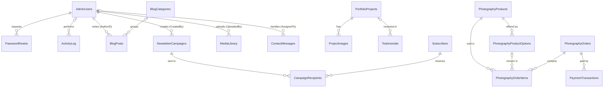

# CMS Architecture

**Status: foundation implemented (Phase 4).** `database/schema.sql` has 29 tables, and `database/migrations.sql` adds `LastEditedBy` and `LastEditedDate` to every editable content table. Install with `php database/setup.php`. Sign-in, permissions, Website Settings, Homepage, About and Services editing are built; the other screens below are still to come.

The schema was tested on a throwaway MariaDB 10.11 database: it loads cleanly, re-running it preserves existing data, and the delete rules, uniqueness rules and subscriber rule below were tested and held.

## 1. How content survives deployments

| Risk | Protection |
|---|---|
| Deploying code replaces content | All content is in database rows, and deployments only replace code files |
| Re-running `schema.sql` wipes data | The file has no `DROP` or `TRUNCATE`; tables use `CREATE TABLE IF NOT EXISTS`, seeds use `INSERT IGNORE` |
| Uploaded files are deleted | `uploads/` is in `.gitignore`. Any deployment that mirrors files must also exclude it, or it will delete everything in that folder |
| Structure needs to change later | `schema.sql` cannot alter existing tables, so changes go in `database/migrations.sql` as additive statements and are recorded in `SchemaMigrations` |

Back up the database and `uploads/` separately. Git holds neither.

## 2. ERD



**Connected groups**

- **Staff and security.** `AdminUsers` links to password resets, the activity log, and everything staff author or handle.
- **Blog.** A post has one author and at most one category.
- **Portfolio.** A project owns many gallery images and can be linked from testimonials.
- **Store.** One checkout is one order. An order contains many items, and each item is a product with an optional print option. Payments attach to the order.
- **Newsletter.** `CampaignRecipients` joins campaigns and subscribers, one row per person per campaign.

**Standalone tables**

- Always one row, created by the schema: `WebsiteSettings`, `HomePageContent`, `AboutContent`.
- No foreign keys: `AboutValues`, `AboutQualifications`, `SitePages`, `Services`, `Collaborators`, `SpeakingEngagements`, `LoginAttempts`, `SchemaMigrations`.

Image columns store a file path and are not foreign keys to `MediaLibrary`, so the media screen must check where a file is used before deleting it. `MediaLibrary.FilePath` is unique, so alt text can be found from a path.

## 3. Table relationships

| Child column | Parent | Required | If the parent is deleted |
|---|---|---|---|
| `PasswordResets.AdminUserID` | `AdminUsers` | Yes | **Cascade** |
| `ActivityLog.AdminUserID` | `AdminUsers` | No | **Set null:** the log entry stays |
| `BlogPosts.AuthorID` | `AdminUsers` | Yes | **Blocked:** deactivate the user instead |
| `NewsletterCampaigns.CreatedBy` | `AdminUsers` | Yes | **Blocked** |
| `MediaLibrary.UploadedBy` | `AdminUsers` | Yes | **Blocked** |
| `ContactMessages.AssignedTo` | `AdminUsers` | No | **Set null:** message becomes unassigned |
| `BlogPosts.CategoryID` | `BlogCategories` | No | **Set null:** post stays, uncategorised |
| `ProjectImages.ProjectID` | `PortfolioProjects` | Yes | **Cascade:** images removed with the project |
| `Testimonials.ProjectID` | `PortfolioProjects` | No | **Set null:** testimonial stays |
| `PhotographyProductOptions.PhotoID` | `PhotographyProducts` | Yes | **Cascade** |
| `PhotographyOrderItems.PhotoID` | `PhotographyProducts` | Yes | **Blocked:** archive the product instead |
| `PhotographyOrderItems.OptionID` | `PhotographyProductOptions` | No | **Set null:** the order keeps its copied label and price |
| `PhotographyOrderItems.OrderID` | `PhotographyOrders` | Yes | **Blocked** |
| `PaymentTransactions.OrderID` | `PhotographyOrders` | Yes | **Blocked:** payment history is permanent |
| `CampaignRecipients.CampaignID` | `NewsletterCampaigns` | Yes | **Blocked** |
| `CampaignRecipients.SubscriberID` | `Subscribers` | Yes | **Cascade:** so a POPIA erasure is complete |

**Other rules enforced by the database:** unique, case-insensitive email on `AdminUsers` and `Subscribers`; unique slugs on every table that has one; unique `OrderNumber`, `PaymentReference`, `DownloadToken` and `UnsubscribeToken`; one person per campaign; one `PaymentTransactions` row per gateway reference and status, so a repeated PayFast notification cannot be recorded twice; prices cannot be negative and quantities must be above zero.

**Slugs** are on every record that can have its own web address: `Services`, `PortfolioProjects`, `Collaborators`, `SpeakingEngagements`, `PhotographyProducts`, `BlogCategories`, `BlogPosts`, `SitePages`. Testimonials, values, qualifications and print options only appear inside other pages, so they have none.

**Design notes on the approved items**

| Item | How it was built |
|---|---|
| Statuses | Draft / Published / Archived on all public content. Workflow tables (orders, messages, campaigns, subscribers) keep their specified values |
| Cart | `PhotographyOrderItems`. `PhotoID` has moved off `PhotographyOrders` |
| Prints and downloads | Both supported until Vanessa decides: `ProductType`, `PhotographyProductOptions`, shipping and delivery columns on orders, an expiring download token |
| Service inclusions | `IncludedItems` and `IdealFor`, one item per line, edited in a text box |
| Values and qualifications | Rows in `AboutValues` and `AboutQualifications`. `AboutContent.CoreValues` (renamed from the reserved word `Values`) and `AboutContent.Qualifications` hold each section's introduction |
| Stored tokens | Password reset and download tokens are stored only as hashes. `UnsubscribeToken` is stored as issued, because each email has to include it |

**Rules the admin screens must enforce** (the database can't check these):

- A testimonial needs a `ConsentDate` before publishing.
- A project needs `ClientPermission` before publishing.
- A collaborator needs a `ConsentDate` before publishing.
- Campaigns only go to `SubscriptionStatus = 'Subscribed'` with a `ConfirmedDate`.
- `WebsiteSettings` street address only appears when `ShowAddress` is on. It is off by default.

**Subscriber rule** (contact form with "Subscribe to Newsletter" ticked). Tested with a new person, an existing person in different capitalisation, and someone who had unsubscribed. The original `Source` and token are kept. Someone returning after unsubscribing must confirm by email again, which closes the gap where anyone could re-subscribe another person's address.

```sql
INSERT INTO Subscribers (Name, Email, Source, ConsentDate, ConsentIP, UnsubscribeToken)
VALUES (?, ?, 'Contact Form', NOW(), ?, ?)
ON DUPLICATE KEY UPDATE
    SubscribedDate = IF(SubscriptionStatus = 'Unsubscribed', CURRENT_TIMESTAMP, SubscribedDate),
    ConfirmedDate  = IF(SubscriptionStatus = 'Unsubscribed', NULL, ConfirmedDate),
    ConsentDate    = VALUES(ConsentDate),
    ConsentIP      = VALUES(ConsentIP),
    SubscriptionStatus = 'Subscribed',
    UnsubscribedDate = NULL,
    Name = COALESCE(Name, VALUES(Name));
```

The order of these assignments matters: `SubscriptionStatus` must change after the two `IF` lines have read it.

## 4. CRUD matrix

"Existing" means the placeholder page is already in `admin/`. All other pages are new. Every form uses CSRF protection and prepared statements. Every change is written to `ActivityLog`.

| Module | Pages | Create | Read | Update | Delete |
|---|---|---|---|---|---|
| Website Settings | `settings.php` (existing) | Seeded | Form | Single form | Never |
| Homepage Content | `homepage-content.php` | Seeded | Form | Single form | Never |
| About Content | `about-content.php` | Seeded | Form | Single form | Never |
| About Values | Panel in `about-content.php` | Inline | Sortable list | Inline, reorder | Archive, then delete |
| Qualifications | Panel in `about-content.php` | Inline | List by type | Inline, reorder | Archive, then delete |
| Site Pages | `site-pages.php`, `site-page-edit.php` | Seeded; form for new pages | List | Form | Archive; the 3 legal pages can't be removed |
| Services | `services.php`, `service-edit.php` | Form | Sortable list | Form, reorder | Archive |
| Portfolio Projects | `portfolio-projects.php`, `project-create.php`, `project-edit.php` (existing) | Form | List, filter by category, type, status | Form | Archive; permanent delete removes images |
| Project Images | Panel in `project-edit.php` | Upload or choose from media | Grid | Caption, alt text, reorder | Remove from project |
| Collaborators | `collaborators.php`, `collaborator-edit.php` | Form | Sortable list | Form, reorder | Archive, then delete |
| Testimonials | `testimonials.php` (existing), `testimonial-edit.php` | Form | List | Form, reorder | Archive, then delete |
| Speaking Engagements | `speaking-engagements.php` (existing), `engagement-edit.php` | Form | List, upcoming and past | Form | Archive, then delete |
| Photography Products | `photography-products.php` (existing), `product-edit.php` | Form | List | Form | Archive; delete only if never ordered |
| Product Options | Panel in `product-edit.php` | Inline | List | Inline, reorder | Archive; delete removes from sale only |
| Photography Orders | `photography-orders.php` (existing), `order-view.php` | Checkout only | List, filter by status and date; CSV export | Order and delivery status, tracking number | Never |
| Order Items | Shown in `order-view.php` | Checkout only | Read-only | Never | Never |
| Payment Transactions | Shown in `order-view.php` | Payment notification only | Read-only | Never | Never |
| Subscribers | `subscribers.php` (existing), `subscriber-edit.php` | Public forms, admin form, CSV import | List, filter by status and source; CSV export | Details and notes | Unsubscribe; permanent delete on POPIA request |
| Newsletter Campaigns | `newsletter-campaigns.php`, `campaign-edit.php` | Form | List with preview | Draft or Scheduled only; Sent is locked | Archive |
| Campaign Recipients | Shown in `campaign-edit.php` | Created at send | Delivery counts and failures | Sender only | Never directly |
| Contact Messages | `enquiries.php` (existing), `enquiry-view.php` | Public form only | Inbox, filter by status, type, assignee | Status, assignee, internal notes; message text locked | Close; permanent delete on POPIA request |
| Blog Categories | `blog-categories.php` | Inline | List with post counts | Inline | Delete; posts become uncategorised |
| Blog Posts | `blogs.php`, `blog-create.php`, `blog-edit.php` (existing) | Form with slug generator | List, filter by status and category | Form with preview | Archive, then delete |
| Media Library | `media-library.php` (existing) | Validated upload | Grid, filter by category and type | Alt text, category | Delete only if the file is unused |
| Admin Users | `admin-users.php` (existing), `admin-user-edit.php` | SuperAdmin only | List, recent login attempts | Details, role, status, password reset | Deactivate |
| Activity Log | `activity-log.php` | Automatic | List, filter by user, record, date | Never | Never by hand; old rows removed by a retention rule |
| Password Resets | No screen | Forgot-password form | Token check | Marked used | Expired rows purged |
| Login Attempts | Summary in Admin Users | Login form | Rate-limit check | Never | Old rows purged |
| Schema Migrations | No screen | Migration run | Migration check | Never | Never |

Public pages read only rows with `Status = 'Published'`. Blog posts also need a `PublishedDate` that has passed.

## 5. Admin navigation

```
Dashboard                  new messages, recent orders, subscriber count, drafts

Website Content
  Homepage Content
  About Content            values and qualifications inside
  Services
  Speaking Engagements
  Testimonials
  Legal & Other Pages

Portfolio
  Projects                 images inside each project
  Collaborators

Blog
  Posts
  Categories

Photography Store
  Products                 print options inside each product
  Orders                   items and payments inside each order

Audience
  Contact Messages
  Subscribers
  Newsletter Campaigns     delivery results inside each campaign

Media Library

System
  Website Settings
  Admin Users
  Activity Log
```

Menu items a role cannot use are hidden, and each page also checks permission on the server.

## 6. Permission matrix

**V** view, **C** create, **E** edit, **P** publish or send, **A** archive, **D** permanent delete, **X** export, **–** no access.

| Module | SuperAdmin | Admin | Editor |
|---|---|---|---|
| Dashboard | V | V | V (content only) |
| Website Settings | V E | V E | – |
| Homepage Content | V E | V E | V E |
| About Content | V E | V E | V E |
| About Values and Qualifications | V C E P A D | V C E P A D | V C E |
| Site Pages (legal) | V C E P A | V C E P A | V |
| Services | V C E P A D | V C E P A | V E |
| Portfolio Projects and Images | V C E P A D | V C E P A D | V C E |
| Collaborators | V C E P A D | V C E P A D | V C E |
| Testimonials | V C E P A D | V C E P A D | V C E |
| Speaking Engagements | V C E P A D | V C E P A D | V C E |
| Blog Categories | V C E D | V C E D | V |
| Blog Posts | V C E P A D | V C E P A D | V C E (own drafts) |
| Media Library | V C E D | V C E D | V C E |
| Photography Products | V C E P A D | V C E P A | V E |
| Product Options and prices | V C E A D | V C E A | V |
| Photography Orders, Items, Transactions | V E X | V E X | – |
| Subscribers | V C E A D X | V C E A | – |
| Newsletter Campaigns | V C E P A | V C E P A | V C E (drafts) |
| Campaign Recipients | V | V | – |
| Contact Messages | V E A D | V E A | – |
| Admin Users and Login Attempts | V C E A | – | – |
| Activity Log | V | – | – |

Editors are kept away from subscribers, messages and orders because those hold personal data, which POPIA requires us to limit. Editors can prepare work, but an Admin publishes it.

Permissions are defined in `includes/permissions.php`. Modules are added to that map as their screens are built, and anything not listed is refused for every role.

**Rules:** the last active SuperAdmin cannot be demoted or deactivated, users cannot change their own role, and permissions live in one PHP map checked by `can('module.action')`.

## 7. Before implementation

- **Table-name case.** XAMPP on Windows stores `AdminUsers` as `adminusers` (confirmed in testing), while Linux hosting is normally case-sensitive. Set `lower_case_table_names=2` in XAMPP's `my.ini` before creating the local database, and run `schema.sql` directly on the server rather than importing a local export.
- **Confirm the MariaDB version** on Xneelo is 10.2.1 or newer; older versions ignore the `CHECK` rules.
- **First SuperAdmin:** `php database/setup.php` creates it. On a host with no command line, `php database/setup.php --print-admin-sql` prints an INSERT to paste into phpMyAdmin. No credentials belong in a public repository.
- **Xneelo limits:** check outbound email limits and cron access before promising bulk newsletter sending from the site.
- **Retention:** decide how long to keep `LoginAttempts`, `ActivityLog` and the IP addresses on messages and subscribers. These are personal data under POPIA.
- **Google Analytics:** store only the Measurement ID, and add a cookie notice.
- **Uploads:** validate real file types, block PHP execution in `uploads/`, keep `DownloadFile` outside the web root, and enable GD locally (it's still off).
