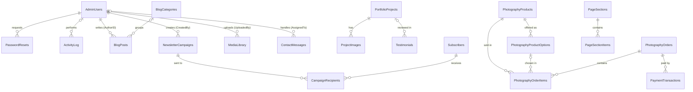

# CMS Architecture

**Status: Phase 8.**

- **Database:** 31 tables. `database/schema.sql` creates 29, and `database/migrations.sql` adds `PageSections` and `PageSectionItems`, edit stamps (`LastEditedBy`, `LastEditedDate`) on every editable content table, Media Library captions and optimisation details, and the starting content.
- **Install:** run `php database/setup.php`.
- **Built:** every content screen the public website needs, and the Media Library.
- **Placeholders only:** blog, photography store, subscriber, contact message and user management screens.

## 1. How content survives deployments

| Risk | Protection |
|---|---|
| Deploying code replaces content | All content is in database rows, and deployments only replace code files |
| Re-running setup wipes or restores data | No `DROP` or `TRUNCATE` anywhere. Tables use `CREATE TABLE IF NOT EXISTS`. Content seeds run once only, so edited or removed text never comes back |
| Uploaded images are deleted | `uploads/` is in `.gitignore`. Any deployment that mirrors files must also exclude it, or every uploaded image is lost |
| Structure needs to change later | Changes go in `migrations.sql` as additive statements, recorded in `SchemaMigrations` |

Back up the database and `uploads/` separately. Git holds neither.

**Migrations so far:** 002 edit stamps · 003 location defaults · 004 services · 005 Home and About wording · 006 page sections · 007 removal of footer menu headings · 008 rename to Colour & Design Psychology · 009 gallery image stamps · 010 service, portfolio, contact and legal page wording · 011 Media Library captions and stamps · 012 image optimisation details.

## 2. ERD



Every editable content table also has `LastEditedBy` → `AdminUsers`. Those links are left out of the diagram for readability.

**Connected groups**

- **Staff and security.** `AdminUsers` links to password resets, the activity log, uploads, and everything staff author, handle or edit.
- **Page wording.** `PageSections` hold headings, introductions and buttons for any page, found by `PageKey` and `SectionKey`. `PageSectionItems` hold their repeating blocks.
- **Portfolio.** A project owns many gallery images and can be linked from testimonials.
- **Blog** (not built). A post has one author and at most one category.
- **Store** (not built). One checkout is one order. An order contains many items, and each item is a product with an optional print option. Payments attach to the order.
- **Newsletter** (not built). `CampaignRecipients` joins campaigns and subscribers, one row per person per campaign.

**Standalone tables**

- Always one row, created by the schema: `WebsiteSettings`, `HomePageContent`, `AboutContent`.
- No foreign keys apart from edit stamps: `AboutValues`, `AboutQualifications`, `SitePages`, `Services`, `Collaborators`, `SpeakingEngagements`, `LoginAttempts`, `SchemaMigrations`.

**Images.** Image columns store a path inside `uploads/` and are not foreign keys to `MediaLibrary`. Instead:

- The admin only accepts a path that exists in `MediaLibrary`.
- The Media Library checks every image column before allowing a delete.
- `MediaLibrary.FilePath` is unique.

## 3. Table relationships

| Child column | Parent | Required | If the parent is deleted |
|---|---|---|---|
| `PasswordResets.AdminUserID` | `AdminUsers` | Yes | **Cascade** |
| `ActivityLog.AdminUserID` | `AdminUsers` | No | **Set null:** the log entry stays |
| `*.LastEditedBy` (every editable table) | `AdminUsers` | No | **Set null:** the edit date stays, the name clears |
| `BlogPosts.AuthorID` | `AdminUsers` | Yes | **Blocked:** deactivate the user instead |
| `NewsletterCampaigns.CreatedBy` | `AdminUsers` | Yes | **Blocked** |
| `MediaLibrary.UploadedBy` | `AdminUsers` | Yes | **Blocked** |
| `ContactMessages.AssignedTo` | `AdminUsers` | No | **Set null:** message becomes unassigned |
| `BlogPosts.CategoryID` | `BlogCategories` | No | **Set null:** post stays, uncategorised |
| `ProjectImages.ProjectID` | `PortfolioProjects` | Yes | **Cascade:** images removed with the project |
| `Testimonials.ProjectID` | `PortfolioProjects` | No | **Set null:** testimonial stays |
| `PhotographyProductOptions.PhotoID` | `PhotographyProducts` | Yes | **Cascade** |
| `PhotographyOrderItems.PhotoID` | `PhotographyProducts` | Yes | **Blocked:** archive the product instead |
| `PhotographyOrderItems.OptionID` | `PhotographyProductOptions` | No | **Set null:** the order keeps its copied label and price |
| `PhotographyOrderItems.OrderID` | `PhotographyOrders` | Yes | **Blocked** |
| `PaymentTransactions.OrderID` | `PhotographyOrders` | Yes | **Blocked:** payment history is permanent |
| `CampaignRecipients.CampaignID` | `NewsletterCampaigns` | Yes | **Blocked** |
| `CampaignRecipients.SubscriberID` | `Subscribers` | Yes | **Cascade:** so a POPIA erasure is complete |
| `PageSectionItems.SectionID` | `PageSections` | Yes | **Cascade:** items are removed with their section |

**Other rules enforced by the database:**

- Unique, case-insensitive email on `AdminUsers` and `Subscribers`.
- Unique slugs on every table that has one, and unique `PageKey` + `SectionKey`.
- Unique `OrderNumber`, `PaymentReference`, `DownloadToken` and `UnsubscribeToken`.
- One person per campaign.
- One `PaymentTransactions` row per gateway reference and status, so a repeated PayFast notification cannot be recorded twice.
- Prices cannot be negative, and quantities must be above zero.

**Slugs** are on every record that can have its own web address: `Services`, `PortfolioProjects`, `Collaborators`, `SpeakingEngagements`, `PhotographyProducts`, `BlogCategories`, `BlogPosts`, `SitePages`. Admin screens build a slug from the title when it is left blank.

**Stored values that differ from what is shown.** `PortfolioProjects.PortfolioCategory` and `ContactMessages.EnquiryType` store `Colour Psychology`. The admin and public forms display it as **Colour & Design Psychology**. The service's web address stays `colour-psychology`.

**Design notes**

| Item | How it works |
|---|---|
| Statuses | Draft / Published / Archived on all public content. Workflow tables (orders, messages, campaigns, subscribers) have their own values |
| Service inclusions | `IncludedItems` and `IdealFor`, one item per line, edited in a text box |
| Values and qualifications | Rows in `AboutValues` and `AboutQualifications`. `AboutContent.CoreValues` and `AboutContent.Qualifications` hold each section's introduction |
| Retired columns | `HomePageContent.IntroductionText` and `AboutContent.Journey`, `ScienceBackground`, `DesignBackground`, `Philosophy` and `SpeakingIntroduction` are empty. Their wording moved to page sections, and they are hidden from the admin |
| Legal page wording | Plain text: a blank line separates paragraphs, `## ` starts a heading, `- ` starts a list item |
| Cart and products | `PhotographyOrderItems` hold cart lines. Prints and digital downloads are both supported until Vanessa decides |
| Stored tokens | Password reset and download tokens are stored only as hashes. `UnsubscribeToken` is stored as issued, because each email has to include it |

**Rules enforced by the admin screens:**

- Projects need `ClientPermission` before publishing. Testimonials and collaborators need a `ConsentDate`. This is checked whoever publishes.
- An Editor never sees the Status or slug fields of publishable content, so anything an Editor creates starts as Draft.
- A street address only appears on the site when `WebsiteSettings.ShowAddress` is on. It is off by default.
- Every image field accepts only an image that is in the Media Library.
- Campaigns will only go to subscribers with `SubscriptionStatus = 'Subscribed'` and a `ConfirmedDate` (newsletter phase).

**Subscriber rule** (for the contact-form phase). When "Subscribe to Newsletter" is ticked, this statement adds the person or re-subscribes them. It was tested with a new person, an existing person in different capitalisation, and someone who had unsubscribed. Someone returning after unsubscribing must confirm by email again.

```sql
INSERT INTO Subscribers (Name, Email, Source, ConsentDate, ConsentIP, UnsubscribeToken)
VALUES (?, ?, 'Contact Form', NOW(), ?, ?)
ON DUPLICATE KEY UPDATE
    SubscribedDate = IF(SubscriptionStatus = 'Unsubscribed', CURRENT_TIMESTAMP, SubscribedDate),
    ConfirmedDate  = IF(SubscriptionStatus = 'Unsubscribed', NULL, ConfirmedDate),
    ConsentDate    = VALUES(ConsentDate),
    ConsentIP      = VALUES(ConsentIP),
    SubscriptionStatus = 'Subscribed',
    UnsubscribedDate = NULL,
    Name = COALESCE(Name, VALUES(Name));
```

The order of these assignments matters: `SubscriptionStatus` must change after the two `IF` lines have read it.

## 4. Media Library

| Feature | How it works |
|---|---|
| Upload from the page | Every image field is a drop zone with a "browse" link. The upload happens immediately and shows a preview. The image is recorded in `MediaLibrary`, with its category set to the screen it came from |
| Reuse | "Choose from library" opens a searchable window, 24 images at a time. The chosen image's description and caption fill any empty matching fields |
| Several at once | The Media Library page and each project's gallery accept multiple dropped files. Gallery drops become gallery images directly |
| Library page | Search by file name, description, caption or category. Filter by category. Previews, 48 per page, with a "Needs description" marker |
| Image details | Edit description (alt text), caption and category. Shows size, dimensions, upload date and every place the image is used |
| Learning descriptions | A description typed on a content form is saved to the library if the image has none, ready for reuse |
| Deleting | Admins only, and only when the image is unused. The file is removed from disk and the deletion is logged |
| Accepted files | JPG, PNG, WebP and GIF up to 10 MB, checked by their actual content. SVG and HEIC are refused |
| Storage | `uploads/media/YYYY/MM/` with a generated name (`name-1a2b3c4d.jpg`), so uploads can't overwrite files or choose their own extension |
| Protection | `.htaccess` blocks scripts anywhere in `uploads/`, confirmed on Apache |
| Optimisation | Every upload is turned upright from the camera's orientation, then saved in three sizes: **main** (up to 1920px wide, used for heroes and stored as `FilePath`), **web** (up to 1200px wide, used for content) and **thumb** (up to 400px on its longest side, used in the admin). JPEG quality 82 and progressive, WebP quality 80, PNG lossless. Images are never enlarged, and a size is never bigger than the upload |
| Originals | The untouched upload is kept in `uploads/originals/`, which the web server refuses to serve. Public versions are re-encoded, removing hidden data such as GPS location |
| Special cases | Animated GIF and WebP files are used as uploaded, so they keep their animation (`Optimisation = 'Unchanged'`). Images over 50 megapixels are refused |
| Failure handling | If an image can't be processed, the upload still succeeds using the original file, the editor sees a warning, the error is logged, and the library marks it "Not optimised" (`Optimisation = 'Failed'`) |
| Metadata | `Width`, `Height` and `FileSize` describe the main image. `OriginalPath`, `OriginalWidth`, `OriginalHeight` and `OriginalFileSize` describe the upload. The details screen lists every size with its dimensions and file size |
| Existing images | Images uploaded before optimisation keep working at full size. `php database/optimise-media.php` converts them without changing any saved path |

## 5. Admin screens

"Built" means a working screen. "Placeholder" means a protected page with a count and a "coming soon" notice. Every form uses CSRF protection and prepared statements. Every save, create and delete is written to `ActivityLog`.

| Module | Pages | Status | Create | Update | Delete |
|---|---|---|---|---|---|
| Dashboard | `dashboard.php` | Built | – | – | – |
| Website Settings | `settings.php` | Built | Seeded | Single form | Never |
| Homepage Content | `homepage-content.php` | Built | Seeded | Single form | Never |
| About Content | `about-content.php` | Built | Seeded | Single form | Never |
| About Values | `about-values.php`, `about-value-edit.php` | Built | Form | Form | Permanent delete |
| Qualifications | `qualifications.php`, `qualification-edit.php` | Built | Form | Form | Permanent delete |
| Page Sections | `page-sections.php`, `section-edit.php` | Built | Developer only | Form | Never (unpublish instead) |
| Section items | `item-edit.php` | Built | Form | Form | Permanent delete |
| Services | `services.php`, `service-edit.php` | Built | Seeded | Form | Never (archive instead) |
| Speaking Engagements | `speaking-engagements.php`, `speaking-edit.php` | Built | Form | Form | Permanent delete |
| Testimonials | `testimonials.php`, `testimonial-edit.php` | Built | Form | Form | Permanent delete |
| Legal Pages | `site-pages.php`, `site-page-edit.php` | Built | Seeded | Form | Never |
| Portfolio Projects | `portfolio-projects.php`, `project-edit.php` | Built | Form | Form, with gallery panel | Permanent delete removes its gallery |
| Project Images | `project-image-edit.php`, gallery drop zone | Built | Drop or form | Form | Permanent delete |
| Collaborators | `collaborators.php`, `collaborator-edit.php` | Built | Form | Form | Permanent delete |
| Media Library | `media-library.php`, `media-edit.php` | Built | Upload | Description, caption, category | Only when unused |
| Blog Posts and Categories | `blogs.php`, `blog-create.php`, `blog-edit.php` | Placeholder | | | |
| Photography Products and Orders | `photography-products.php`, `photography-orders.php` | Placeholder | | | |
| Subscribers, Newsletter Campaigns | `subscribers.php` | Placeholder | | | |
| Contact Messages | `enquiries.php` | Placeholder | | | |
| Users | `admin-users.php` | Placeholder | Via `setup.php` only | | |
| Activity Log | Latest 8 entries on the dashboard, SuperAdmin only | Partial | Automatic | Never | Never |

Public pages show only rows with `Status = 'Published'`. Projects also need client permission; collaborators also need a consent date.

## 6. Admin navigation (as built)

```
Dashboard

Website Content
  Homepage Content
  About Content
  About Values
  Qualifications
  Page Sections            every page's headings, buttons and repeating items
  Services
  Speaking Engagements
  Testimonials
  Legal Pages

Portfolio & Blog
  Portfolio Projects       gallery inside each project
  Collaborators
  Blogs                    placeholder

Photography
  Photography Products     placeholder
  Photography Orders       placeholder

Audience
  Subscribers              placeholder
  Contact Messages         placeholder

Library
  Media Library

System
  Website Settings
  Users                    placeholder
```

Menu items a role cannot use are hidden, and each page also checks permission on the server.

## 7. Permission matrix

**V** view, **C** create, **E** edit, **P** publish, **A** archive, **D** permanent delete, **X** export, **–** no access. This matches `includes/permissions.php`. SuperAdmin may perform every action listed for a module.

| Module | SuperAdmin | Admin | Editor |
|---|---|---|---|
| Dashboard | V | V | V (content only) |
| Website Settings | V E | V E | – |
| Homepage Content, About Content | V E | V E | V E |
| About Values and Qualifications | V C E P A D | V C E P A D | V C E |
| Page Sections and items | V C E P A D | V C E P A D | V C E |
| Services | V C E P A D | V C E P A | V E |
| Portfolio Projects and Images | V C E P A D | V C E P A D | V C E |
| Collaborators | V C E P A D | V C E P A D | V C E |
| Testimonials | V C E P A D | V C E P A D | V C E |
| Speaking Engagements | V C E P A D | V C E P A D | V C E |
| Legal Pages | V E P | V E P | V |
| Media Library | V C E D | V C E D | V C E |
| Blog (planned) | V C E P A D | V C E P A D | V C E |
| Photography Products (planned) | V C E P A D | V C E P A | V E |
| Photography Orders (planned) | V E X | V E X | – |
| Subscribers (planned) | V C E A D X | V C E A | – |
| Contact Messages (planned) | V E A D | V E A | – |
| Users (planned) | V C E A | – | – |
| Activity Log | V | – | – |

- **Personal data:** Editors are kept away from subscribers, messages and orders because those hold personal data, which POPIA requires us to limit.
- **Publishing:** Editors prepare content, and an Admin publishes it. An Editor can still change wording on content that is already Published.
- **Fail-safe:** a permission that isn't in the map is refused for every role.
- **For the Users screen (planned):** the last active SuperAdmin must not be demoted or deactivated, and users must not be able to change their own role.

## 8. Deployment notes

- **Table-name case.** XAMPP on Windows can store `AdminUsers` as `adminusers`, while Linux hosting is case-sensitive. Use `lower_case_table_names=2` locally, and run `setup.php` on the server rather than importing a local export.
- **MariaDB 10.2.1 or newer** is needed, or the `CHECK` rules are ignored.
- **First SuperAdmin:** `php database/setup.php` creates it. On a host with no command line, `php database/setup.php --print-admin-sql` prints an INSERT to paste into phpMyAdmin.
- **Uploads:** PHP must be able to write to `uploads/`, and the PHP upload limit must allow 10 MB files.
- **Email phase:** check Xneelo's outbound email limits and cron access before building newsletter sending.
- **Retention:** decide how long to keep `LoginAttempts`, `ActivityLog` and IP addresses. These are personal data under POPIA.
- **Analytics:** store only the Google Analytics Measurement ID, and add a cookie notice.
